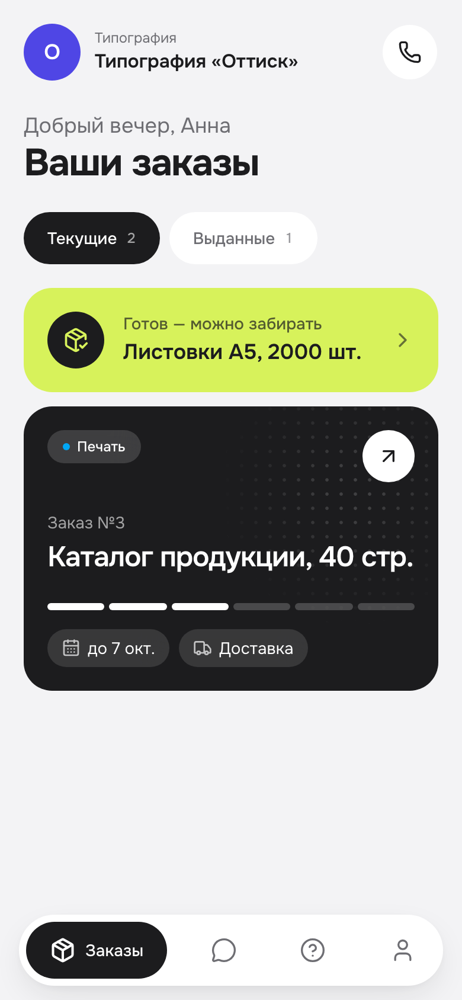
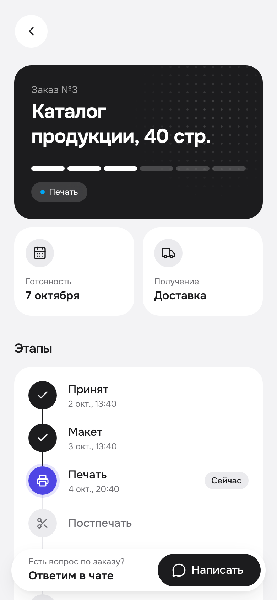
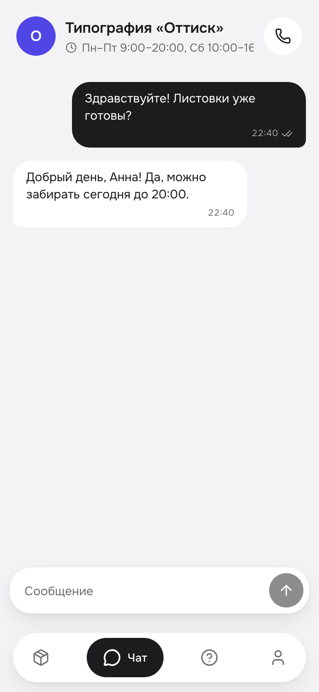
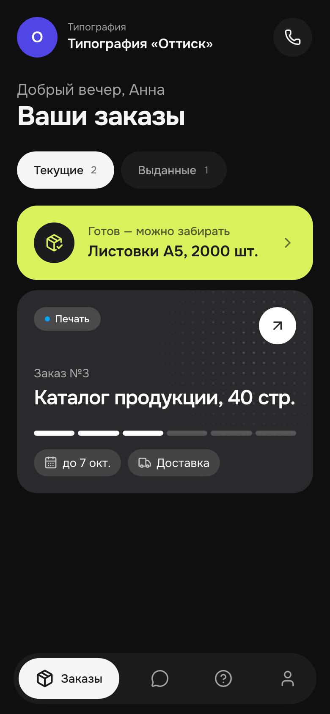
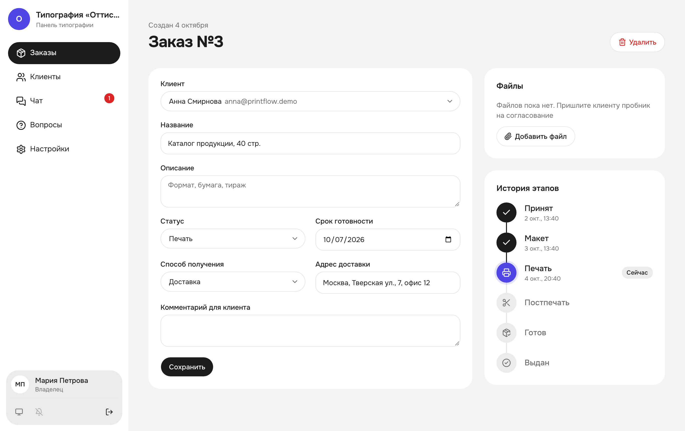

# PrintFlow — приложение для типографии

Готовый шаблон: клиенты типографии сами видят статус и сроки заказов, присылают макеты и пишут менеджеру,
а типография ведёт заказы в удобной панели. Клиентская часть — PWA: ставится на телефон как обычное приложение,
в фирменном цвете и с логотипом типографии.

<p>
  
  
  
  
</p>


## Возможности

**Для клиентов** (`/c/<адрес-типографии>`)
- Заказы со статусом, сроком и способом получения; готовые заказы выделены
- Этапы заказа с датой и временем каждого шага: Принят → Макет → Печать → Постпечать → Готов → Выдан
- Файлы в заказе: клиент прикрепляет макет или фото, типография присылает пробник на согласование (до 50 МБ).
  На телефоне — из галереи, с камеры или из файлов и облака, на компьютере можно перетащить мышкой
- Чат с менеджером в реальном времени, отметки о прочтении
- Уведомления на телефон и по email: смена статуса, новый файл, ответ менеджера
- Калькулятор стоимости визиток и баннеров (`/c/<адрес>/calculator`, работает и без входа): цена пересчитывается сразу,
  с детализацией; «Оформить заказ» создаёт заявку с расчётом, сотрудники получают уведомление
- Баннеры типографии с акциями и услугами на главном экране и в разделе «О компании», просмотр во весь экран
- Вопросы и ответы, контакты типографии (звонок, Telegram, почта, маршрут), профиль
- Регистрация, вход, восстановление пароля; светлая и тёмная тема; установка на экран «Домой»
- Сделано под телефон, на планшете и компьютере экран шире, списки в две колонки

**Для типографии** (`/admin`)
- Заказы: поиск, фильтры (включая просроченные), смена статуса и срока прямо в таблице, плитки с цифрами
- Карточка заказа с файлами и историей этапов; клиенты и их заказы; владелец удаляет клиента вместе с заказами, файлами и перепиской
- Все диалоги чата, счётчик непрочитанных, уведомления сотрудникам о новых сообщениях и файлах; сотрудники удаляют сообщения
  и очищают переписку целиком (клиенты свои сообщения не удаляют: лимит сообщений в минуту считает сохранённые)
- Папки чатов «Активные» и «Завершённые»: новое сообщение возвращает чат в активные, звёздочка у клиента, который пишет
  не первый раз; поиск по имени клиента и тексту сообщений
- Заявки из калькулятора с расчётом клиента; стоимость заказа в таблице и в карточке, сотрудник может её уточнить
- Цены калькулятора (`/admin/prices`, только владелец): тиражи, бумага, ламинация, материалы, люверсы, срочность,
  отключение позиций и пример расчёта, который пересчитывается при правке
- Вопросы и ответы для клиентов; настройки: название, логотип, контакты (включая Telegram), часовой пояс;
  баннеры с акциями (до 10, порядок и подписи)
- Роли: владелец (всё, включая настройки) и сотрудник

**Под капотом**
- Next.js 16, TypeScript, Tailwind CSS 4, shadcn/ui; Supabase (Postgres, Auth, Realtime, Storage)
- Доступ к данным защищён на уровне базы (Row Level Security), покрыт автотестами
- Два варианта запуска: свой сервер в России — приложение и Supabase целиком на нём (Docker), данные не покидают РФ; или Vercel + Supabase Cloud

## Быстрый старт (на своём компьютере)

Нужны Node.js 20+, Docker Desktop и Git.

```bash
npm install
npx supabase start          # локальная Supabase в Docker; в конце выведет ключи
cp .env.example .env.local  # заполните из вывода: API URL, anon key, service_role key, DB URL
npm run seed                # демо-типография «Оттиск»: 3 клиента, 10 заказов
npm run dev                 # http://localhost:3000
```

Демо-доступы (пароль у всех `Demo1234!`): клиент `anna@printflow.demo` → `/c/demo`, владелец `owner@printflow.demo` → `/admin`.
Письма локально не уходят наружу — их видно в Mailpit: http://localhost:54324.

## Установка для своей типографии

Два варианта:
- **Свой сервер в России** — для типографий в РФ. Приложение и Supabase (база, вход, файлы, чат) работают на одном сервере в России:
  персональные данные клиентов не покидают РФ (152‑ФЗ), всё открывается без VPN.
- **Vercel + Supabase Cloud** — запуск за 10 минут, но серверы за рубежом: в России без VPN сайт может не открываться.

### Свой сервер в России (Selectel, Timeweb и т. п.)

Сервер: 2 vCPU / 4 ГБ / 50 ГБ, Ubuntu 24.04 (у Selectel — VDS 2‑4‑50, ~650 ₽/мес). 2 ГБ не хватит: рядом с приложением
работает Supabase. Файлы клиентов хранятся на диске сервера, их объём ограничен только диском.

1. В DNS добавьте две A-записи на IP сервера: `app.example.ru` и `sb.app.example.ru`.
2. На сервере под root:
   ```bash
   git clone <ваш-репозиторий> printflow && cd printflow
   cp deploy/.env.example deploy/.env && nano deploy/.env   # домен, название, почта
   sh deploy/install.sh
   ```
   Скрипт ставит Docker, скачивает официальный Supabase для своего сервера (версия закреплена в `install.sh`),
   создаёт пароли и ключи (`deploy/supabase/.env`), собирает приложение, применяет миграции и включает ночные бэкапы.
   HTTPS-сертификаты Caddy выпускает сам. Наружу открыты только порты 80 и 443: база и Studio из интернета недоступны.
3. Типография и владелец:
   ```bash
   cd deploy/supabase
   docker compose run --rm tools scripts/create-company.ts --name "Типография «Оттиск»" --slug ottisk \
     --email owner@ottisk.ru --password 'Надёжный-пароль' --owner "Мария Петрова" \
     --phone "+7 (495) 123-45-67" --address "Москва, ул. Полиграфическая, 12" --color "#4f46e5"
   ```
4. Менеджеры (по одному на человека; `--role owner` — ещё один владелец):
   ```bash
   docker compose run --rm tools scripts/create-staff.ts --slug ottisk \
     --email manager@ottisk.ru --password 'Надёжный-пароль' --name "Ольга Иванова"
   ```

- **Обновление:** `git pull && sh deploy/install.sh` — пересобирает приложение и применяет новые миграции, ключи и данные не трогает.
  Этой же командой применяются изменения в `deploy/.env`.
- **Логи и состояние:** в `deploy/supabase` — `sh run.sh logs app`, `sh run.sh status`.
- **Studio** (таблицы, пользователи, SQL): с вашего компьютера `ssh -L 54333:127.0.0.1:54333 root@<IP-сервера>`,
  затем откройте http://localhost:54333.
- **Почта:** SMTP в `deploy/.env` (Яндекс: `smtp.yandex.ru`, 465, пароль приложения). С этого ящика уходят письма
  подтверждения и восстановления пароля (шаблоны — `supabase/templates/`) и уведомления клиентам.
- **Бэкапы:** каждую ночь в 3:30 — база и файлы в `deploy/backups/`, хранятся 14 дней; вручную — `sh deploy/backup.sh`.
  Чтобы копия была и вне сервера, заполните `BACKUP_S3_*` в `deploy/.env` (S3-хранилище в России: Selectel, Yandex Object Storage,
  VK Cloud) — каждую ночь новые бэкапы уходят туда же, старше 14 дней удаляются. Без него забирайте их вручную:
  `scp -r root@<IP>:printflow/deploy/backups ./`.
  Восстановление, в том числе на новом сервере после `install.sh`: `sh deploy/restore.sh <…_db.dump> <…_files.tar.gz>`.
- Если сервер не скачивает образы с Docker Hub, укажите зеркало вашего хостинга в `/etc/docker/daemon.json` (`registry-mirrors`).

### Vercel + Supabase Cloud

1. Создайте проект на [supabase.com](https://supabase.com) (регион — Frankfurt или ближайший).
2. Заполните `.env.local` по образцу `.env.example` (ключи: Settings → API, строка подключения: Settings → Database → Session pooler).
3. Примените схему базы: `npm run db:push`.
4. **Authentication → URL Configuration**: Site URL — адрес вашего сайта (`https://app.example.ru`), в Redirect URLs добавьте `https://app.example.ru/**`.
5. **Authentication → Email Templates**: вставьте HTML из `supabase/templates/confirmation.html` (Confirm signup) и `supabase/templates/recovery.html` (Reset password). Тогда ссылки из писем ведут на ваш домен, а не на `supabase.co`.
6. **Authentication → Emails → SMTP Settings**: подключите свою почту (например, Яндекс 360). Встроенная почта Supabase отправляет всего несколько писем в час.
7. **Authentication → Sign In / Providers → Email**: минимальная длина пароля — 8. «Confirm email» — на ваше усмотрение: включите, если хотите подтверждать почту клиентов.
8. **Authentication → Rate Limits**: все запросы идут с адреса вашего сервера, поэтому при большом числе клиентов поднимите лимиты входа и обновления токенов.
9. Типография и владелец:
   ```bash
   npm run create-company -- --name "Типография «Оттиск»" --slug ottisk \
     --email owner@ottisk.ru --password 'Надёжный-пароль' --owner "Мария Петрова" \
     --phone "+7 (495) 123-45-67" --address "Москва, ул. Полиграфическая, 12" --color "#4f46e5"
   ```
    Менеджеры: `npm run create-staff -- --slug ottisk --email manager@ottisk.ru --password '…' --name "Ольга Иванова"`.
10. Импортируйте репозиторий в Vercel, добавьте переменные окружения из `.env.example` (кроме `DATABASE_URL`;
    `SUPABASE_SERVICE_ROLE_KEY` нужен для уведомлений) и нажмите Deploy.

Логотип, контакты и баннеры потом меняются в панели: `/admin/settings`. Клиенты регистрируются сами по ссылке
`https://app.example.ru` (корень сайта ведёт в приложение вашей типографии).

### Персональные данные (152‑ФЗ)

- При регистрации клиент ставит галочку согласия на обработку персональных данных; время согласия хранится в профиле
  и видно в карточке клиента в панели.
- Политика конфиденциальности — `/c/<адрес>/privacy`, заполняется названием, адресом и контактами из настроек.
  Это шаблон: проверьте текст с юристом.
- Типография как оператор персональных данных подаёт уведомление в Роскомнадзор (pd.rkn.gov.ru), если ещё не подавала.
- Запрос клиента на удаление данных: владелец удаляет клиента в его карточке — аккаунт, заказы, файлы и переписка удаляются
  без возможности восстановления.
- На своём сервере в России данные клиентов не покидают РФ; вариант с Supabase Cloud хранит их за рубежом.

## Уведомления

- **Push на телефон и компьютер.** На своём сервере ключи создаёт `install.sh`. На Vercel: сгенерируйте `npx web-push generate-vapid-keys`
  и заполните `NEXT_PUBLIC_VAPID_PUBLIC_KEY`, `VAPID_PRIVATE_KEY`, `VAPID_SUBJECT`; также нужен `SUPABASE_SERVICE_ROLE_KEY`. Клиент включает уведомления в профиле,
  сотрудник — кнопкой с колокольчиком внизу меню. На iPhone push работает после установки приложения на экран «Домой» (iOS 16.4+).
- **Email клиентам** о новых заказах, смене статуса и файлах от типографии: заполните `SMTP_*` (на своём сервере — в `deploy/.env`).
- Без ключей уведомления просто выключены, всё остальное работает.

## Настройка под себя

- **Бренд**: логотип, контакты и часовой пояс — в `/admin/settings`; фирменный цвет задаётся при создании типографии (`--color`). Название продукта во вкладке — `NEXT_PUBLIC_APP_NAME`.
- **Дизайн**: правила и токены — в [DESIGN.md](DESIGN.md), цвета — в `src/app/globals.css`. Фирменный цвет компании используется как акцент, основные кнопки тёмные.
- **Этапы заказа**: подписи и цвета — `STATUSES` в `src/lib/types.ts` (набор этапов задан enum `order_status` в миграциях).
- **Калькулятор**: цены — в панели (`/admin/prices`); формулы, продукты и их варианты — в `src/lib/pricing.ts`
  (там же цены по образцу, которые `create-company` даёт новой типографии). Цена заявки всегда пересчитывается на сервере.
- **Демо-стенд**: `DEMO_MODE=true` показывает на главной лендинг продукта с демо-доступами.

## Проверки

```bash
npm run typecheck && npm run lint
npm run test:unit    # формулы калькулятора (src/lib/pricing.ts)
npm run test:rls     # изоляция данных между типографиями и ролями (на локальной Supabase)
npm run test:e2e     # сценарии в браузере: npx playwright install chromium; приложение на :3000 с демо-данными
```

## Безопасность

- Все запросы идут под сессией пользователя, доступ к строкам решают политики RLS в Postgres: клиент видит только свои заказы,
  файлы и переписку, сотрудник — только свою типографию.
- Служебный ключ Supabase используется только на сервере — для рассылки уведомлений после проверенного действия, в скриптах и тестах.
- Ограничения: лимит попыток входа, регистрации и восстановления пароля; не больше 20 сообщений в минуту; лимиты длины полей;
  файлы до 50 МБ в приватном хранилище со ссылками на скачивание на 2 минуты.
- Заголовки Content-Security-Policy, Permissions-Policy, X-Frame-Options; HTTPS обязателен.
- На своём сервере наружу открыты только 80 и 443: из Supabase доступны лишь API, которые использует приложение;
  база и Studio — только изнутри сервера или через SSH-туннель.

## Устройство проекта

```
supabase/migrations/     схема, RLS, триггеры, хранилища
supabase/templates/      письма подтверждения и восстановления пароля
scripts/                 create-company (новая типография), seed (демо-данные)
deploy/                  свой сервер: install.sh, Supabase + приложение + Caddy, миграции, бэкапы
src/app/c/[slug]/        клиентское приложение (PWA)
src/app/admin/           панель типографии
src/app/auth/            подтверждение email, восстановление пароля
src/app/actions/         серверные действия
src/lib/notify.ts        push и email уведомления
tests/                   тест RLS и e2e-тесты (Playwright)
```

## Ограничения

- Один email — один аккаунт в одной типографии.
- Сотрудник, открывший клиентское приложение, попадает в панель.
- Лимит попыток входа хранится в памяти процесса: на своём сервере работает полностью, на Vercel — в пределах экземпляра функции
  (за ним остаются лимиты Supabase Auth).
- Нет онлайн-оплаты и офлайн-режима — см. [ROADMAP.md](ROADMAP.md).
